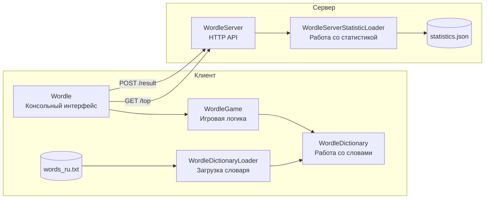

# Wordle4j

Консольная игра Wordle на Java с русским словарём, системой подсказок и HTTP-сервером для ведения рейтинга игроков.


## О проекте

**Wordle4j** — реализация популярной игры Wordle для командной строки. Программа загадывает случайное русское слово из пяти букв, а задача игрока — угадать его за шесть попыток.

После каждого хода игра показывает, какие буквы угаданы правильно, присутствуют в загаданном слове или отсутствуют в нём.

Проект состоит из двух независимых компонентов:

- **Клиент** — игровая логика и взаимодействие с пользователем через консоль.
- **Сервер** — HTTP-сервис для сохранения результатов побед и получения таблицы лидеров.

Для реализации используются стандартная библиотека Java, Gson для работы с JSON и JUnit 5 для тестирования.

## Возможности

- **Русский словарь.** При загрузке из исходного файла отбираются слова из пяти букв.
- **Нормализация слов.** Регистр не имеет значения, буква `ё` приводится к `е`.
- **Подсказки компьютера.** Программа предлагает слово, которое соответствует всем результатам предыдущих попыток.
- **Обработка повторяющихся букв.** Алгоритм корректно учитывает количество вхождений каждой буквы.
- **Рейтинг игроков.** После победы результат отправляется на сервер. Игра отображает топ-10 и личное место игрока.
- **Автономная работа.** Недоступность сервера не мешает продолжить игру.
- **Логирование.** Загрузка словаря записывается в `wordle.log`.

## Правила игры

Необходимо угадать загаданное слово из пяти букв за шесть попыток.

После каждой попытки программа выводит последовательность из пяти символов:

| Символ | Значение |
|:---:|---|
| `+` | Буква присутствует в слове и находится на правильной позиции |
| `^` | Буква присутствует в слове, но находится на другой позиции |
| `-` | Буква отсутствует в слове или её вхождения уже учтены |

Если игрок вводит пустую строку, программа предлагает подсказку.

Некорректный ввод — слово неправильной длины, с латинскими буквами или отсутствующее в словаре — не расходует попытку.

## Технологии

| Технология | Назначение |
|---|---|
| Java 11+ | Основной язык разработки |
| `com.sun.net.httpserver.HttpServer` | HTTP-сервер |
| Gson 2.8.7 | Сериализация и десериализация JSON |
| JUnit Jupiter 5.4.2 | Модульное тестирование |
| Git | Контроль версий |

## Быстрый запуск

### Требования

- JDK 11 или новее.
- Терминал с поддержкой UTF-8.
- Gson 2.8.7 — библиотека уже находится в каталоге `lib`.

### 1. Клонирование

```bash
git clone https://github.com/Ni-ki-ta-ta/higher-web-practice-wordle4j-net.git
cd higher-web-practice-wordle4j-net
```

### 2. Компиляция

**Windows (PowerShell или CMD):**

```bat
mkdir out
javac -encoding UTF-8 -cp "lib/gson-2.8.7.jar" -d out src/ru/yandex/practicum/*.java
```

**Linux / macOS:**

```bash
mkdir -p out
javac -encoding UTF-8 -cp "lib/gson-2.8.7.jar" -d out src/ru/yandex/practicum/*.java
```

### 3. Запуск сервера

Сервер необходим для сохранения результатов и отображения рейтинга. Его можно запустить отдельно:

**Windows:**

```bat
java -cp "out;lib/gson-2.8.7.jar" ru.yandex.practicum.WordleServer
```

**Linux / macOS:**

```bash
java -cp "out:lib/gson-2.8.7.jar" ru.yandex.practicum.WordleServer
```

По умолчанию сервер запускается на порту `8080`.

### 4. Запуск игры

Откройте второй терминал в корне проекта. Файл `words_ru.txt` должен быть доступен из текущей рабочей директории.

**Windows:**

```bat
java -Dfile.encoding=UTF-8 -cp "out;lib/gson-2.8.7.jar" ru.yandex.practicum.Wordle
```

**Linux / macOS:**

```bash
java -Dfile.encoding=UTF-8 -cp "out:lib/gson-2.8.7.jar" ru.yandex.practicum.Wordle
```

Если сервер не запущен, основная игровая функциональность остаётся доступной, но результаты не будут отправлены в рейтинг.

## Тестирование

Тесты находятся в каталоге `test/` и написаны с использованием JUnit Jupiter 5.4.2.

Их можно запускать из IntelliJ IDEA, выбрав папку `test` и команду **Run All Tests**. Необходимые библиотеки JUnit находятся в каталоге `lib/`.

| Тестовый класс | Что проверяет |
|---|---|
| `WordleDictionaryTest` | Нормализацию слов, поиск и случайный выбор |
| `WordleDictionaryLoaderTest` | Загрузку и фильтрацию словаря, обработку пустого словаря |
| `WordleGameTest` | Игровой процесс, победу и поражение, валидацию ввода и подсказки |
| `WordleServerStatisticLoaderTest` | Сохранение статистики, обновление результатов и формирование рейтинга |
| `WordleTest` | Создание игрового объекта |

## Архитектура

Проект разделён на клиентскую и серверную части.



### Структура проекта

```text
higher-web-practice-wordle4j-net/
├── lib/                          # Gson и JUnit
├── src/
│   └── ru/yandex/practicum/
│       ├── Wordle.java
│       ├── WordleGame.java
│       ├── WordleDictionary.java
│       ├── WordleDictionaryLoader.java
│       ├── WordleServer.java
│       ├── WordleServerStatisticLoader.java
│       ├── PlayerStatistic.java
│       └── *Exception.java
├── test/
│   └── ru/yandex/practicum/      # Модульные тесты
├── words_ru.txt                  # Русский словарь
└── README.md
```

## HTTP API

Сервер предоставляет два эндпоинта для работы с результатами игры.

Данные сохраняются в `statistics.json`, который создаётся рядом с сервером при первой записи статистики.

### POST `/result`

Сохраняет результат победы игрока.

**Тело запроса:**

```json
{
  "nickname": "nikita",
  "wins": 1,
  "steps": 4,
  "usedHints": false
}
```

**Ответ:**

```json
{
  "status": "ok"
}
```

При успешной обработке сервер возвращает `200 OK`. Для нового игрока создаётся запись, для существующего обновляется количество побед.

### GET `/top?nickname={nickname}`

Возвращает таблицу лидеров, отсортированную по количеству побед.

- В ответ включаются до десяти лучших игроков.
- Если указанный игрок не входит в топ-10, его запись добавляется в конец ответа с фактическим местом в рейтинге.

**Пример ответа:**

```json
[
  {
    "nickname": "nikita",
    "wins": 7,
    "steps": 4,
    "place": 1,
    "usedHints": false
  },
  {
    "nickname": "anonymous",
    "wins": 3,
    "steps": 5,
    "place": 2,
    "usedHints": true
  }
]
```

Для неподдерживаемых HTTP-методов сервер возвращает `405 Method Not Allowed`.

## Особенности реализации

### Расчёт подсказок

Для сравнения введённого и загаданного слов используется двухэтапный алгоритм:

1. Сначала отмечаются точные совпадения — `+`. Эти буквы считаются использованными.
2. Затем для оставшихся букв проверяется наличие ещё не учтённых вхождений в загаданном слове. При наличии ставится `^`, иначе `-`.

Такой подход позволяет правильно обрабатывать повторяющиеся буквы.

### Подбор подсказки

Компьютер перебирает слова из словаря и проверяет, какие из них соответствуют результатам всех предыдущих попыток.

Слово считается подходящим, если при сравнении с каждым ранее введённым словом оно даёт ту же последовательность подсказок, что и загаданное слово.

Уже предложенные варианты повторно не используются.

## Возможные улучшения

- [ ] Кодирование никнейма в URL с помощью `URLEncoder`.
- [ ] Учёт использования подсказок при формировании рейтинга.
- [ ] Настройка длины слова и количества попыток.
- [ ] Настройка адреса и порта сервера через аргументы командной строки.
- [ ] Добавление Maven или Gradle для управления зависимостями и сборкой.
